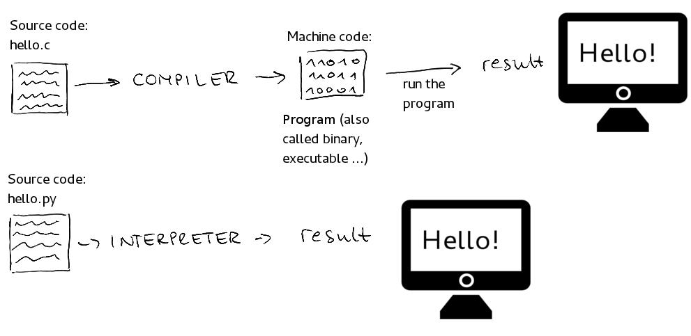

## What is JS?

- JavaScript is a scripting language.
- JavaScript is a **dynamically typed, synchronous, single-threaded** language.

> **Dynamically typed:** Means no need to provide type.
>
> **Synchronous:** Means executed line-by-line:
> - In a sequence.
> - Only move to the next line if the current line is executed successfully.
> - Cannot execute by skipping any line/block of code.
>
> **Single-threaded:** Means executed only one line at a time:
> - Cannot execute two or more lines or blocks of code at once.
> - Cannot do parallel execution.
> - Cannot do multi-tasking.

---

## JS Engine

- JS doesn't have its own engine.
- JS runs on browsers such as Chrome, Mozilla Firefox, and Safari.
- JS uses the browser's engine, such as:
  - Chrome — V8 engine
  - Firefox — SpiderMonkey
  - Safari — JavaScriptCore

---

## ECMAScript

`ECMAScript (ES)` is the standard that defines the **syntax, rules, and features** of the **JavaScript** programming language. It specifies how JavaScript should behave, and JavaScript engines implement these rules so JavaScript code can run.

- It is developed and maintained by `TC39 (Technical Committee 39)` within `Ecma International`.
- `ECMAScript` primarily standardizes **JavaScript**, not all scripting languages.

### Relation between ECMAScript and JS

- **ECMAScript:** Defines the language specification (the rules and features).
- **JavaScript:** The programming language that follows the `ECMAScript` standard.
- **JavaScript Engine:** Software that executes JavaScript code, such as `V8` (Chrome and Node.js) and `SpiderMonkey` (Firefox).

---

## History and Versions

- JavaScript was created by `Brendan Eich` in `May 1995`, at `Netscape`, in approximately `10` days.
  - `Netscape Communications Corporation` was an American technology company best known for developing the `Netscape Navigator` web browser.
  - In `1995`, `Netscape` hired `Brendan Eich` to develop a scripting language for making web pages interactive.
- The language was initially called `Mocha`, then `LiveScript`, before being renamed `JavaScript`.
- JavaScript was submitted to `Ecma International` for standardization, and the first `ECMAScript` standard was published in `1997`.

The versions were commonly named after the edition numbers of ECMAScript:

- `ES1` — ECMAScript 1 (1997)
- `ES3` — ECMAScript 3 (1999)
- `ES5` — ECMAScript 5 (2009)

After ES6, the JS version was named after the release year. For example:

- `ES6` (2015) — now called `ES2015`
- `ES7` (2016) — now called `ES2016`
- `ES8` (2017) — now called `ES2017`
- `ES17` (2026) — now called `ES2026`

---

## Compiled vs Interpreted Language

The core difference between **compiled** and **interpreted** languages lies in **when and how** the source code is translated into machine-readable binary (1s and 0s).

A compiled language translates the entire program at once before execution, while an interpreted language translates and executes the code line by line at runtime.



### Key Differences

| Feature | Compiled Languages | Interpreted Languages |
|---|---|---|
| **Translation Process** | **All at once:** A tool called a compiler processes the entire source code upfront. | **Line by line:** A tool called an interpreter reads, translates, and executes instructions on the fly. |
| **Output File** | Generates a standalone **executable file** (like an `.exe` or a native binary). | No standalone file is produced; it requires the **raw source code** to run. |
| **Execution Speed** | **Fast:** The translation is already finished, allowing the CPU to run the binary directly. | **Slower:** The system must dedicate processing power to translate the code during execution. |
| **Error Detection** | Errors are caught **before the program runs** during the compilation step. | Errors are encountered **only when that specific line of code is executed**. |
| **Portability** | **Platform-dependent:** The generated executable is tailored to a specific OS and CPU architecture. | **Platform-independent:** The same source code can run on any device that has a compatible interpreter installed. |
| **Development Cycle** | **Slower feedback:** Even minor code modifications require waiting for a full rebuild/recompilation. | **Fast prototyping:** Changes can be tested instantly without an explicit build phase. |
| **Examples** | C, C++, Java, Go, Rust | Python, JavaScript, PHP, Ruby |

### Working of Different Programming Languages

#### C / C++

```text
C / C++ → Source Code → Compiler → Machine Code → CPU → Output
```

#### Python (CPython)

```text
Python → Source Code → Bytecode Compiler → Bytecode → Interpreter → Output
```

> **How Python executes bytecode:**
>
> Source Code → Bytecode → Interpreter's existing Machine Code executes the bytecode → Output
>
> Here, the interpreter generally executes bytecode using its existing machine-code instructions. Your Python code is **not** normally compiled into native machine code.

#### Java

```text
Java → Source Code → javac Compiler → Bytecode → JVM (Interpreter / JIT) → Machine Code → CPU → Output
```

```text
Java Source Code (.java)
        ↓
Java Compiler (javac)
        ↓
Bytecode (.class)
        ↓
JVM (Interpreter / JIT Compiler)
        ↓
Machine Code
        ↓
CPU
        ↓
Output
```

1. Source code is compiled into bytecode before execution.
2. The JVM starts executing the bytecode using its interpreter.
3. The JVM monitors which parts of the code run frequently.
4. The JIT compiler compiles selected, **frequently executed parts** into machine code.
5. The CPU executes that machine code directly.

What about code that runs only once? It may remain interpreted rather than being JIT-compiled.

> **Remember:** JIT compilation happens at runtime, and it typically focuses on frequently executed code to **improve performance**. The exact strategy depends on the runtime implementation.

#### JavaScript (Modern Engines)

```text
JavaScript → Source Code → JavaScript Engine (Interpreter / JIT Compiler) → Machine Code → CPU → Output
```

```text
JavaScript source code
        ↓
V8 engine
        ↓
Ignition compiler
        ↓
Bytecode
        ↓
Ignition interpreter
        ↓
JIT compiler (frequently executed code)
        ↓
Machine code
        ↓
CPU
        ↓
Output
```

Modern JavaScript engines can convert JavaScript source code into bytecode. The exact process depends on the engine.

For example, Google's V8 engine (used by Chrome and Node.js) works roughly like this:

1. **Source code:** You write JavaScript.
2. **Parser:** The engine parses the source code.
3. **Bytecode generation:** V8's Ignition compiler generates bytecode.
4. **Interpretation:** Ignition executes the bytecode.
5. **JIT compilation:** V8's optimizing compiler can compile **frequently executed** code into machine code.
6. **CPU:** Executes the generated machine code.

**When does bytecode conversion happen?**

At runtime, when the JavaScript engine processes your code, before or as it begins executing the relevant code.

> **Note:** This describes V8's general approach. Other JavaScript engines may use different internal representations and execution strategies.

> **Key takeaway:** A language doesn't inherently have to be only compiled or only interpreted. Its **implementation** determines how its code is **translated and executed**.

---

## JIT Compilation

JIT compilation is a technique in which a runtime compiles code into machine code while the program is running.

### Example

1. **JavaScript code** — the source code you write.
2. **Interpreter** — starts executing the code.
3. **JIT compiler** — compiles frequently executed code into machine code and optimizes it.
4. **CPU** — executes the machine code.

### How JIT Makes JS Fast

It can make programs run faster by **optimizing** code that executes **frequently**.

### Why Is JIT Faster Than Interpretation?

The main reason is how the CPU executes the instructions.

#### 1. Interpretation: Bytecode → Execution

An interpreter reads bytecode instructions and executes them through the interpreter's own machine-code instructions.

For example, for each bytecode instruction, the interpreter generally needs to:

1. Read the bytecode instruction.
2. Determine what operation it represents.
3. Execute that operation.
4. Move to the next instruction.

These **extra interpretation** steps add **overhead**, especially when the same code runs repeatedly.

#### 2. JIT Compilation: Bytecode → Machine Code → Execution

A JIT compiler translates frequently executed bytecode into native machine code while the program is running.

After compilation:

1. The CPU executes the generated machine code directly.
2. The interpreter doesn't need to repeatedly decode those instructions.
3. The JIT compiler may optimize the code to make it run faster.

### Remember the Difference

- **Interpreter:** Executes code through interpretation.
- **JIT compiler:** Compiles code into machine code while the program is running.
- **AOT compiler:** Compiles code before the program runs.

### What Is AOT?

AOT (Ahead-of-Time) compilation is commonly used in compiled languages, such as C and C++, but it is not limited to them.

- **C/C++:** Typically use AOT compilation to compile source code into machine code before execution.
- **Java:** The `javac` compiler compiles source code into bytecode ahead of time, while the JVM may use JIT compilation to convert bytecode into machine code during execution.
- **JavaScript:** Traditionally interpreted, but modern engines such as V8 use JIT compilation. Some JavaScript tools can also compile code ahead of time.

> `AOT` and `JIT` describe **when compilation happens**, not whether a language is classified as compiled or interpreted.